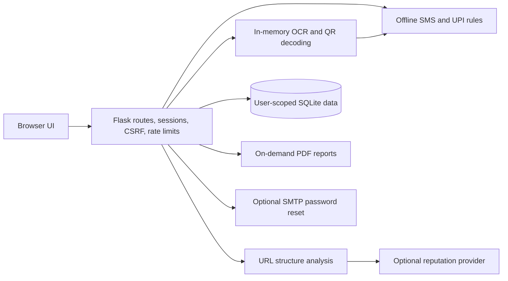

# UPI Shield AI

Flask application for analyzing SMS and UPI messages, with user accounts, scan history, and profile photos.

## Technology stack

Python 3.10+, Flask 3.1.3, SQLite, Flask-WTF/CSRF, Flask-Limiter, Gunicorn for Linux deployment, Pillow and pytesseract with the separate Tesseract OCR engine, zxing-cpp for local QR decoding, vanilla JavaScript/CSS, and a standard-library PDF report generator. The local Windows workflow uses the Python development server; production uses the included Docker and Gunicorn configuration.

## Local setup

Python 3.10 or newer is required. From the project directory, create and activate a virtual environment, then install the declared dependencies:

```powershell
python -m venv .venv
.\.venv\Scripts\Activate.ps1
python -m pip install -r requirements.txt
```

For local development, copy `.env.example` to `.env` and set a random `FLASK_SECRET_KEY`. The app loads `.env` only outside production and never overrides variables already set in the shell. `.env` is ignored by Git. Production reads secrets from the deployment environment.

```powershell
Copy-Item .env.example .env
$env:FLASK_SECRET_KEY = (python -c "import secrets; print(secrets.token_hex(32))")
python app.py
```

Open `http://127.0.0.1:5000`. The app uses the existing `database.db` by default. Set `DATABASE_PATH` to use a different database file. The app does not recreate or initialize the database on startup.

The workspace configures VS Code and Code Runner to use `.venv\Scripts\python.exe`. If VS Code was already open when the environment was created, reload the window or select the workspace interpreter with **Python: Select Interpreter**.

## Existing accounts and passwords

New accounts use Werkzeug password hashes. `migrate_passwords.py` makes a consistent SQLite backup in the system temporary directory, verifies that snapshot, then hashes existing plaintext password values in one transaction. User IDs, profile fields, scan rows, and the schema remain unchanged. It verifies row fingerprints and SQLite integrity after migration and reports the recovery-copy path. The operation is idempotent. Stop the app before running it:

```powershell
python migrate_passwords.py
```

Keep the recovery copy until existing users have logged in successfully and their scan history has been checked. A successful login also upgrades a remaining legacy value, which supports accounts if the explicit migration command has not yet been run.

## Environment variables

| Variable | Purpose |
| --- | --- |
| `FLASK_SECRET_KEY` | Required secret for production; a random temporary key is generated for local development if omitted. |
| `APP_ENV` | Set to `production` to enable secure session cookies and disable debug mode. |
| `FLASK_DEBUG` | Enables debug mode only in non-production environments when set to `true`. |
| `DATABASE_PATH` | Optional SQLite database path; defaults to the project’s `database.db`. |
| `UPLOAD_FOLDER` | Optional profile-photo folder; defaults to `static/uploads`. |
| `RATELIMIT_STORAGE_URI` | Flask-Limiter backend URI; defaults to process-local `memory://` for development. Production deployments with multiple workers should configure a shared backend. |
| `URL_REPUTATION_PROVIDER` | Set to `google_safe_browsing` to use Google's Safe Browsing Lookup API. Unsupported provider names return `UNKNOWN`. |
| `GOOGLE_SAFE_BROWSING_API_KEY` | Optional API key. If unset, reputation results are `UNKNOWN`; the app does not call the provider. |
| `URL_REPUTATION_TIMEOUT_SECONDS` | Per-request timeout, from 0.1 to 30 seconds; defaults to 4. A single transient server error can trigger one short retry. |
| `URL_REPUTATION_MAX_URLS_PER_SCAN` | Maximum URL count checked per scan; defaults to 5. Additional URLs remain `UNKNOWN`. |
| `MAIL_HOST`, `MAIL_PORT` | SMTP delivery host and port supplied by your email provider. |
| `MAIL_USERNAME`, `MAIL_PASSWORD` | Optional SMTP credentials; set both or neither. Keep them in deployment secrets, never source control. |
| `MAIL_FROM` | Sender address authorized by the provider. |
| `MAIL_USE_TLS`, `MAIL_USE_SSL` | Use STARTTLS (default `true`) or implicit TLS (`MAIL_USE_SSL=true`) according to provider instructions. Do not disable transport encryption in production. |
| `MAIL_TIMEOUT_SECONDS` | SMTP connection timeout; defaults to 10 seconds. |
| `OCR_LANGUAGES` | Tesseract language codes; defaults to `eng+hin` and requires both trained-data files. |

Production must set `APP_ENV=production`, use HTTPS, supply a strong `FLASK_SECRET_KEY`, and provide secrets through the deployment environment. Production does not load `.env`. The default in-memory rate-limit backend is intended for local development and does not share counters across processes or survive restarts.

## Database preservation

`database.py` provides `initialize_database()` for creating missing tables with `CREATE TABLE IF NOT EXISTS`; it does not drop existing tables. The application does not call it automatically. SQLite foreign-key checks are enabled on every application connection.

The production container creates a schema only when its configured database path does not exist. An existing SQLite file is left alone. If an existing database needs the additive password-reset table, run `provision_database.py` explicitly: it creates and verifies a consistent recovery copy first, runs only the existing `CREATE TABLE IF NOT EXISTS` initializers, and confirms the prior table row counts and database integrity. It does not hash passwords, remove records, or switch database engines.

## Personal Scam Safety Centre

The dashboard calculates category counts, score ranges, and eight-week scan trends from the signed-in user's existing `scan_history` rows. Category labels are recomputed with the current offline heuristic rules, so historical category breakdowns can change when those rules are updated. The dashboard and history page do not display saved SMS text. The history page supports downloading a report for an individual scan and deleting only that user's selected history row. Deletion is permanent; profile images and accounts are not affected. Every history, deletion, and report query is scoped by the authenticated user ID. These features require no database migration.

## Educational simulator and PDF reports

The Scam Safety Simulator uses fixed fictional examples for KYC, job, reward, urgent-payment, and remote-access scenarios. Answers and scenario activity are not saved. Scan reports use the Python standard library and require no PDF package or external service. Each report includes the recorded score and date, current-rule category/reasons, URL-host structure findings, and safety steps. It intentionally excludes the original message, URL paths/query strings, account email, credentials, and OTPs. Reasons are recomputed with the current rule set; the stored score is the value recorded when the scan occurred. Reports are available only to the owner of the scan. OCR image scans are not saved and therefore do not have downloadable scan-history reports.

The analytics, simulator, and reports are awareness aids. Rule-based scores are not calibrated probabilities. Current URL reputation results are returned with scans but are not persisted in scan history; a later PDF report includes URL structure only and does not perform a reputation lookup. A provider no-match does not establish that a message or domain is safe.

## URL reputation setup

The legacy adapter targets Google's deprecated Safe Browsing Lookup API v4, which Google documents as non-commercial only. Do not enable it for a commercial product. Existing non-commercial testing uses an HTTPS `POST` to `threatMatches:find`; the URL is sent unhashed. Migrate to Google Web Risk or another suitable commercial provider before revenue-generating operation. See Google's [v4 API and deprecation guidance](https://developers.google.com/safe-browsing/v4), [usage restrictions](https://developers.google.com/safe-browsing/v4/usage-limits), and [Web Risk overview](https://docs.cloud.google.com/web-risk/docs/overview).

For existing non-commercial tests only, configure the legacy adapter with a Google API key in ignored local `.env` or deployment secret storage. Restrict the key to the Safe Browsing API and server-side use. Restart Flask after changing configuration. Do not treat this setup as suitable for a commercial release.

The checker sends extracted HTTP/HTTPS URLs, including paths and query strings, to Google when the key is configured. This applies to scanned messages, reviewed OCR text, and HTTP/HTTPS URLs found in QR codes. The app never visits those URLs or downloads their content. URL strings and API keys are not written to application logs; cache keys use hashes. Results are cached in process memory. A provider match returns `MALICIOUS`, provider no-match returns `SAFE` unless local structure checks raise it to `SUSPICIOUS`, and malformed URLs, missing credentials, timeouts, rate limits, or provider failures return `UNKNOWN`. URLs beyond the per-scan limit are also `UNKNOWN`. These results are not proof of safety.

Google's positive response cache lifetime is used for matched threats; short local lifetimes apply to no-match and transient error results. The cache is process-local, so each production worker has its own entries. No live provider check is run by the automated test suite.

## Password reset email setup

Password reset uses the SMTP endpoint provided by your email delivery provider. Configure `MAIL_HOST`, `MAIL_PORT`, `MAIL_FROM`, and (when required) `MAIL_USERNAME`/`MAIL_PASSWORD` as environment variables or deployment secrets. Choose `MAIL_USE_TLS=true` for STARTTLS (default) or `MAIL_USE_SSL=true` for implicit TLS according to the provider; exactly one secure transport mode must be enabled. `MAIL_TIMEOUT_SECONDS` bounds SMTP connection time. Credentials are never stored in SQLite. When delivery is not configured, the reset form returns a setup message and creates no reset token. When a request is accepted, the UI uses a generic response and does not claim a message was delivered.

For local PowerShell testing, put the SMTP host and provider-issued credentials in your ignored `.env` file or set them in the shell (do not commit them):

```powershell
$env:MAIL_HOST = "smtp.your-provider.example"
$env:MAIL_PORT = "587"
$env:MAIL_USERNAME = "your-smtp-username"
$env:MAIL_PASSWORD = "your-provider-issued-secret"
$env:MAIL_FROM = "verified-sender@your-domain.example"
$env:MAIL_USE_TLS = "true"
$env:MAIL_USE_SSL = "false"
```

After setting variables, restart the Flask process. The app accepts email addresses without revealing whether they belong to registered accounts. SMTP delivery has to be tested against your provider separately; test-suite mocks do not confirm delivery.

### Troubleshooting

- `UNKNOWN` with `missing_credentials`: configure `GOOGLE_SAFE_BROWSING_API_KEY` and restart.
- `UNKNOWN` with `authentication_failed`: check that the key is valid and the API is enabled for its project.
- `UNKNOWN` with `rate_limited`: review the provider quota and retry later.
- `UNKNOWN` with `timeout` or `provider_unavailable`: check outbound HTTPS access and provider availability; the scan still completes.
- Password reset reports that email is not configured: set `MAIL_HOST`, `MAIL_FROM`, one secure transport mode, and matching username/password values if authentication is required.
- SMTP connection failure: verify the provider host/port, TLS versus SSL mode, sender authorization, and network egress. The application keeps the response generic and invalidates an undelivered code.

Before deploying Phase 4, stop the app and run the additive, backup-first migration once:

```powershell
.\.venv\Scripts\python.exe migrate_phase4.py
```

The script creates a new SQLite recovery copy in the system temporary directory, validates it, then creates only the `password_reset_tokens` table. It checks that existing user and scan-history row counts and SQLite integrity are unchanged. Keep the recovery copy in a protected location. Reset codes expire after 10 minutes, are single-use, allow five verification attempts, and have a 60-second resend cooldown. Configure a shared rate-limit backend when deploying multiple workers.

## Local image OCR setup

The Python dependency `pytesseract` is only a wrapper. Install the separate Tesseract OCR engine and its English (`eng`) and Hindi (`hin`) trained data. On Windows, use the installer linked from the [Tesseract installation guide](https://tesseract-ocr.github.io/tessdoc/Installation.html), add its install directory to `PATH`, and open a new terminal. Verify setup:

```powershell
tesseract --version
tesseract --list-langs
```

The language list must include `eng` and `hin` for the default `OCR_LANGUAGES=eng+hin`. If Tesseract is not on `PATH` or in its standard Windows install location, set `TESSERACT_CMD` to the executable path (for example, `C:\\Program Files\\Tesseract-OCR\\tesseract.exe`) before starting the app. The checker page reports whether the local engine and configured language data are available; if only one configured language is installed, scans use that available language and the page reports the missing one. OCR runs locally in memory: uploaded scam screenshots and extracted text are not written to disk or scan history. The route accepts PNG/JPEG up to 4 MB and 20 million pixels, requires login and CSRF, and applies a shared image extraction rate limit. Very large valid images are downscaled in memory; OCR tries the original and a bounded grayscale/contrast-enhanced version, with one rotation retry if no readable text is found. The checker lets the user review and edit OCR text before sending it to the existing scam-pattern detector; image text is not saved. OCR does not verify payment receipts, logos, or image authenticity. Poor image quality or missing Tesseract/language data can prevent OCR and will return an explicit error rather than a safety verdict.

## QR code analysis

Image scanning also decodes QR codes locally with `zxing-cpp` (Apache-2.0; installed from a prebuilt wheel where available). On this project's Windows Python 3.14 setup, PyPI provides a Windows x64 wheel; a source build requires a C++20 compiler. It reads the validated image in memory and does not open links or initiate payments. QR URLs are passed to the existing offline URL-structure analyzer. Reputation is not checked. Displayed QR content redacts common payment/account query values, and decoding a QR code does not show that its destination, recipient, or payment request is safe. The `zxing-cpp` binding is a local native dependency; it adds no cloud or API cost.

## Stage 2 production deployment

### Hosting recommendation

**Recommended: Render, using the Docker Blueprint in `render.yaml`, one paid web instance, and its persistent disk.** The app uses raw SQLite connections and SQLite-specific queries, so one persistent filesystem is the smallest production change. Render terminates TLS, redirects HTTP to HTTPS, supports custom domains and HTTP health checks, and supports Docker services. Its persistent disk keeps changes across deploys and restarts, is encrypted at rest, and has automatic daily snapshots kept for seven days. A persistent disk is available only on a paid service and prevents horizontal scaling and zero-downtime deploys. This design therefore runs one Gunicorn worker and is intended for an early, low-volume MVP. [Render web services](https://render.com/docs/web-services), [persistent disks](https://render.com/docs/disks), [health checks](https://render.com/docs/health-checks)

| Option | Current cost reference | Fit for this app |
| --- | --- | --- |
| **Render (selected)** | The `1c-2g` web plan is listed at $25/month; a 1 GB persistent disk is $0.25/month, before applicable bandwidth or snapshot charges. | Docker, managed TLS and custom domains, health checks, logs, and persistent local storage fit the current Flask + SQLite + Tesseract stack. The attached disk requires one instance and trades away zero-downtime deployments. |
| Railway | Hobby starts at $5/month and includes usage credit; service CPU, memory, egress, and volume usage are metered. | Docker, volumes, PostgreSQL, and volume backup features are available. Costs depend on resource use; it is also viable for a single instance, but Render's disk and health-check deployment layout is documented here. |
| Fly.io | A continuously running 256 MB shared CPU machine starts at $2.19/month; volume storage is $0.15/GB-month. Managed PostgreSQL starts at a substantially higher tier. | Docker and volumes work, but machine, volume, region, TLS, and managed database operations need more platform-specific setup. |
| VPS (DigitalOcean example) | Basic Droplets start at $4/month for 1 vCPU and 512 MiB RAM. | Lowest simple VM price and full control, but the operator owns Linux patching, reverse proxy/TLS, process supervision, firewalling, monitoring, and backup recovery. |

Prices are USD and were checked on 2026-11-23; recheck provider pricing before creating a service. Render lists the selected 1 CPU / 2 GB plan at $25/month and persistent disks at $0.25/GB-month. Railway and Fly.io publish usage-based prices; DigitalOcean lists its basic Droplets by size. [Render compute plans](https://render.com/docs/compute-plans), [Render pricing](https://render.com/pricing), [Railway plans and usage rates](https://docs.railway.com/pricing/plans), [Fly.io pricing](https://fly.io/docs/about/pricing/), [DigitalOcean Droplet pricing](https://www.digitalocean.com/pricing/droplets)

Docker is used because the OCR feature needs the separate Tesseract engine and Hindi trained data in addition to Python packages. The image installs those OS packages, uses a pinned production Python dependency set, excludes local databases and uploaded files, and runs Gunicorn as an unprivileged `app` account after preparing the mounted data directory. The pinned `zxing-cpp` release publishes a Linux `manylinux` wheel compatible with Python 3.12, so the image does not need a C++ build toolchain. [zxing-cpp on PyPI](https://pypi.org/project/zxing-cpp/3.1.1/) The Flask development server refuses to start when `APP_ENV=production`.

### Render setup

No Render account, paid service, or domain has been created. To deploy later:

1. Review the repository changes and commit only the application and deployment files you intend to publish. Keep `.env`, SQLite files, backups, and uploaded photos out of source control. Do not use `git add .` in this workspace: it contains pre-existing Stage 1 changes, a tracked local database, and untracked files. The tracked database must be removed from the Git index while preserving its local copy before publishing; `.gitignore` cannot untrack a file already committed.
2. Push the reviewed source to a private Git repository you control. In Render, create a Blueprint from that repository and review the proposed paid `1c-2g` web service and 1 GB disk before accepting any charges.
3. The Blueprint configures the disk at `/var/data`, one instance, the `/health/ready` health check, Gunicorn, strict production settings, and a daily backup at 02:15 UTC. Render supplies the service hostname; `APP_ALLOWED_HOSTS` uses it by default. The generated Flask secret stays in Render's environment and is not in the source tree.
4. For a brand-new service, the container initializes an empty schema only if `/var/data/database.db` does not exist. For an existing database, follow the data import steps below before directing traffic to it. An existing file is never overwritten by container startup.
5. Watch the deploy and service logs, then verify `/health/live`, `/health/ready`, registration, login, a scan, profile-photo upload, and a password reset using test accounts and mocked or configured integrations. The health probes do not prove SMTP or Google API reachability; those statuses start as `unknown` and reflect the last real integration attempt.

For a custom domain, add it in the Render service's domain settings, create the DNS records Render specifies, and wait for its TLS certificate to become active. Set `APP_ALLOWED_HOSTS` to a comma-separated list containing the Render hostname and each custom hostname. Render sends health-check requests using a verified custom hostname, so that hostname must be allowed. Verify the HTTPS certificate and HTTP-to-HTTPS behavior before setting `HTTPS_VERIFIED=true` and `ENABLE_HSTS=true`. HSTS is intentionally disabled by default and is set for one year on the verified hostname only; the app does not enable `includeSubDomains` or preload.

### Production environment variables

The Render Blueprint supplies the paths and single-instance settings. Set optional provider credentials in the service's secret environment settings, never in `render.yaml`, `.env.example`, or an image layer.

| Variable | Production behavior |
| --- | --- |
| `APP_ENV` | Required `production`; disables Flask debug and `.env` loading. |
| `FLASK_SECRET_KEY` | Required random value of at least 32 bytes. Render generates one in the Blueprint. Keep it stable between deploys so signed sessions remain valid. |
| `APP_ALLOWED_HOSTS` | Comma-separated accepted hostnames. Defaults to Render's `RENDER_EXTERNAL_HOSTNAME`; add each verified custom domain. |
| `TRUSTED_PROXY_HOPS` | Must be explicitly set for production. Render uses `1`; set it to the exact number of trusted reverse proxies in front of Flask. |
| `FORCE_HTTPS` | Must be `true` in production. Render redirects HTTP at its load balancer; Flask also redirects non-health traffic if the trusted proxy says the request was HTTP. |
| `HTTPS_VERIFIED`, `ENABLE_HSTS` | Both default to `false`. After checking the certificate and redirect on the real domain, set both to `true` to emit HSTS. Startup rejects HSTS enabled before verification. |
| `DATABASE_PATH` | SQLite file path; Render Blueprint uses `/var/data/database.db`. |
| `UPLOAD_FOLDER` | Profile photo path; Render uses `/var/data/uploads`. Photos are served only to the signed-in owner. |
| `BACKUP_DIRECTORY` | Verified SQLite backup directory; Render uses `/var/data/backups`. |
| `ENABLE_SCHEDULED_BACKUPS` | `true` on Render. The single Gunicorn worker starts one daily UTC scheduler. |
| `BACKUP_HOUR_UTC`, `BACKUP_MINUTE_UTC` | Daily backup time in UTC; Blueprint defaults to 02:15. |
| `BACKUP_RETENTION_COUNT`, `BACKUP_RETENTION_DAYS` | Defaults to 30 copies and 30 days. Retention always preserves at least two valid backups. |
| `URL_REPUTATION_PROVIDER`, `GOOGLE_SAFE_BROWSING_API_KEY` | Existing Stage 1 provider settings. Keep the key in the host's secret store. |
| `URL_REPUTATION_TIMEOUT_SECONDS`, `URL_REPUTATION_MAX_URLS_PER_SCAN` | Existing bounded provider timeout and per-scan lookup cap. |
| `MAIL_HOST`, `MAIL_PORT`, `MAIL_USERNAME`, `MAIL_PASSWORD`, `MAIL_FROM`, `MAIL_USE_TLS`, `MAIL_USE_SSL`, `MAIL_TIMEOUT_SECONDS` | Existing SMTP settings. Store credentials in the host's secret store; use exactly one encrypted SMTP mode. |
| `PASSWORD_RESET_TTL_SECONDS`, `PASSWORD_RESET_RESEND_SECONDS`, `PASSWORD_RESET_MAX_ATTEMPTS`, `PASSWORD_RESET_CODE_DIGITS` | Optional OTP controls; default to 10 minutes, 60 seconds, 5 tries, and 8 digits, with bounds validated at startup. |
| `OCR_LANGUAGES`, `TESSERACT_CMD` | Defaults to English + Hindi. The Docker image includes both language packs; local Windows may set `TESSERACT_CMD`. |
| `RATELIMIT_STORAGE_URI` | Defaults to process-local `memory://`, which is appropriate only for the current one-worker/one-instance layout. A future scaled deployment needs a shared Redis-compatible backend. |
| `PORT` | Supplied by Render; Gunicorn binds to `0.0.0.0:$PORT` (Render defaults to 10000). |

Local development can continue using `python app.py` on Windows. Gunicorn is isolated to `requirements-production.txt`, because it is not a Windows development server.

### Database setup and migration

SQLite connections remain short-lived, enable foreign keys, and use a 10-second busy timeout. Connection pooling is not appropriate for this local-file database. The attached Render disk is the persistence boundary. Reports are generated on demand and are not stored in a separate table. Do not set `DATABASE_PATH` to a PostgreSQL URL: this app uses SQLite `?` parameters, `COLLATE NOCASE`, `strftime`, SQLite rows, and PRAGMA checks; there is no PostgreSQL driver or adapter in this release.

For an existing local SQLite database and its profile photos:

1. Run a consistent snapshot using SQLite's online backup API: `python backup_database.py --database .\database.db --directory .\secure-recovery`. Keep the source database and snapshot unchanged until cutover is verified.
2. Create the Render service and disk, then upload the snapshot and any existing profile-photo files to a private staging directory on the mounted disk. Do not put user data in the Docker image or Git repository.
3. In the service shell, restore the snapshot to a new path, for example: `python restore_database.py /var/data/import/database-<timestamp>.sqlite3 --target /var/data/database-import.sqlite3`. The command refuses an existing target and refuses to overwrite the configured active database.
4. If the imported database lacks `password_reset_tokens`, run `DATABASE_PATH=/var/data/database-import.sqlite3 BACKUP_DIRECTORY=/var/data/backups python provision_database.py`. This creates another recovery copy first and applies only the additive schema setup. On PowerShell use `$env:DATABASE_PATH = '...'` and `$env:BACKUP_DIRECTORY = '...'` before invoking the script.
5. Set Render's `DATABASE_PATH` to `/var/data/database-import.sqlite3`, ensure `UPLOAD_FOLDER=/var/data/uploads`, restart the service, and verify `/health/ready`, user/scan counts from the script output, owner login, history, and photos before reopening normal traffic. Keep the previous database and recovery backups until the verification window is complete.

The import and restore helpers have been tested only with temporary SQLite databases in this workspace. No live user database has been migrated, and no production migration is claimed.

### PostgreSQL migration and rollback path

PostgreSQL is the future option if the app needs multiple web instances, higher write concurrency, or managed database failover. Before that change, add and test a database adapter, translate SQLite placeholders and `COLLATE NOCASE` / date aggregation queries, replace PRAGMA health checks, and select a bounded connection pool. Back up SQLite with `backup_database.py`; import all user, scan, reset-token, and related rows in a staging copy; compare row counts, key-field fingerprints, constraints, and login/history behavior; then schedule a maintenance cutover. Keep the original SQLite snapshot read-only until the PostgreSQL deployment is verified. If it fails, point the service back to the preserved SQLite path and redeploy the last SQLite-compatible application version. No PostgreSQL migration code or real-data migration was performed for Stage 2.

### Monitoring and security behavior

- `/health/live` returns a minimal liveness response without opening the database.
- `/health/ready` checks the database file, required tables, and a simple query. It reports only safe status labels for the optional email and URL-reputation integrations; it never probes providers on every health check or returns paths, credentials, exception details, or user data.
- JSON application logs contain a generated request ID, method, Flask endpoint name, response code, and duration. They omit URLs, query strings, remote addresses, request bodies, account identities, and scan contents. Unexpected exceptions return a generic error and log only their class and request ID. `X-Request-ID` is returned to the client.
- Responses receive a CSP compatible with the existing inline styles and the existing Unsplash dashboard image, plus clickjacking, MIME-sniffing, referrer, and permissions-policy headers. All non-static responses use `Cache-Control: no-store`.
- Session cookies are HTTPOnly, `SameSite=Lax`, and Secure in production. CSRF protection and existing auth/OTP rate limits remain enabled. Production sets Flask trusted hosts and uses `ProxyFix` only when the configured proxy-hop count is nonzero.
- Profile photos are stored outside the static tree on Render and served only to the owning logged-in user. Uploads retain extension, MIME, signature, image decode, byte-size, and pixel-count checks. OCR and QR uploads remain in memory.
- The current `memory://` rate-limit backend is process-local and resets on restart. It is acceptable only for this single worker and does not provide durable or cross-instance abuse counters. Add a shared store before scaling or operating multiple workers.

### Backups and restoration

`backup_database.py` uses `sqlite3.Connection.backup()` so writes and WAL state are handled by SQLite rather than by copying a live database file. It validates the snapshot with `PRAGMA integrity_check` and `foreign_key_check`, writes a timestamped `.sqlite3` file with restrictive permissions where supported, then applies retention while preserving at least two valid copies. It logs only a filename, row counts, and failure class. The Gunicorn worker schedules the daily copy at the configured UTC time.

Run a manual backup with:

```powershell
.\.venv\Scripts\python.exe backup_database.py
```

To test a restore, always choose a new temporary path. The script will refuse to overwrite any existing file or the configured active database:

```powershell
.\.venv\Scripts\python.exe restore_database.py C:\secure-backups\database-<timestamp>.sqlite3 --target $env:TEMP\upi-shield-restore-test.sqlite3
```

Inspect the printed integrity and row counts, then remove the temporary test database after review. Do not run a restore test against `DATABASE_PATH`. For an actual recovery, stop normal traffic, restore to a new path, validate counts and integrity, then change `DATABASE_PATH` to that verified path and restart. Preserve the previous file as a rollback point until post-recovery checks pass.

App backups and profile photos are on the same persistent disk, so they are not a separate failure domain. Render also keeps encrypted daily disk snapshots for seven days. For stronger disaster recovery, copy verified backups to separately controlled encrypted storage and test retrieval there; no off-site storage credentials or bucket were created for this task. Provider snapshots and app-level copies are separate mechanisms, not a guarantee against every outage.

### Deployment rollback and troubleshooting

- A code-only Render rollback can use its prior deploy; an attached SQLite disk is shared with the service, so do not roll back database files as part of a code rollback. This Stage 2 change makes no destructive schema migration.
- If an imported database is faulty, restore the service's previous `DATABASE_PATH` value and redeploy. If recovery from a backup is needed, restore it to a new filename and switch the environment variable only after integrity and row-count validation.
- `APP_ALLOWED_HOSTS` errors: include the exact service hostname and custom domain(s), without scheme, path, or port.
- `TRUSTED_PROXY_HOPS` errors: set the actual proxy chain count (Render: `1`). Do not trust arbitrary `X-Forwarded-*` values from direct public clients.
- HTTPS redirect loops: verify Render's proxy headers and `TRUSTED_PROXY_HOPS=1`; health routes are exempt from redirect enforcement.
- `/health/live` succeeds but `/health/ready` returns 503: check that `DATABASE_PATH` is on the mounted disk, the file is writable by the `app` user, and the required tables exist. Run the backup-first `provision_database.py` only after confirming the selected database path.
- OCR setup failures: confirm Tesseract and `eng`/`hin` language data in the image, and check service memory before increasing upload limits.
- Password reset not delivered: configure SMTP secret values and validate sender authorization and outbound access. Health reports only the last observed state; it does not send a test email.

## Tests

Run the complete workflow tests with the project virtual environment:

```powershell
.\.venv\Scripts\python.exe -m unittest discover -s tests -v
```

Tests use temporary SQLite databases and temporary upload directories; they do not modify the project database or existing uploaded images.

## Stage 3 product quality and release preparation

The current target is **UPI Shield AI v1.0.0**. This is a release checklist target only; no release, deployment, or public service has been created.

### Architecture



The SMS and UPI detector is an explainable heuristic system. Its score is a bounded rule score, not a calibrated probability. URLs with no provider result and QR payment payloads remain `UNKNOWN`; a provider no-match is not proof of safety. OCR text is reviewed by the user before analysis. OCR and QR image uploads are processed in memory and are not saved to scan history.

### Stage 3 detection and evaluation

Detection responses now include a risk level, reasons, identified indicators, a recommended action, and analysis limitations. Credential rules look for a request to disclose or enter a code, and suppress common explicit warnings not to share one. Generic payment, refund, cashback, job, and utility wording was narrowed to reduce obvious false positives. Empty SMS input is `UNKNOWN`. QR payment requests are not presented as verified-safe; structural URL findings remain separate from provider reputation.

The offline evaluation is reproducible with:

```powershell
.\.venv\Scripts\python.exe evaluation\run_evaluation.py --output evaluation\results\stage3.json
```

The runner makes no network calls, records class distribution and confusion counts, and keeps synthetic scenarios separate from the public SMS corpus. Source attribution, licenses, collection metadata, preprocessing, the excluded engineered-feature phishing dataset, and dataset-specific limits are documented in [`evaluation/README.md`](evaluation/README.md) and [`evaluation/manifest.json`](evaluation/manifest.json). The 48 synthetic SMS rows are author-written rule-path checks, not real-world accuracy evidence. The 5,574-row UCI SMS corpus is old and out of domain: its spam labels do not mean UPI fraud, so its low recall is a limitation signal rather than a product accuracy claim. URL and QR fixture metrics cover structural heuristics only; they do not measure reputation-provider or camera-decoding performance.

No representative, independently labeled Indian UPI SMS, URL-reputation, OCR, or QR image corpus is included. Collecting and licensing such a corpus, then evaluating on a held-out set, remains a release-quality limitation.

### UI and performance changes

The home page, dashboard, checker, auth and reset forms, history, profile, and simulator now share a navy and emerald visual system. The checker uses actual request progress instead of a simulated AI delay, shows explicit `UNKNOWN` states, and presents safety actions and limitations. Navigation, keyboard focus, reduced-motion behavior, upload feedback, and touch-sized controls were improved. Dashboard aggregate counts and risk buckets are computed in SQLite; category reanalysis is limited to the latest 250 rows, while only the latest 10 scans are displayed. Two additive indexes support user-scoped scan ordering and weekly date filtering. No throughput or latency claim is made without a benchmark workload.

The responsive markup/CSS checks and pending rendered-browser gate are recorded in [`RELEASE_CHECKLIST.md`](RELEASE_CHECKLIST.md). The requested widths are 360, 375, 390, 430, 768, 1024, 1366, and 1920 pixels. Headless Chrome and Edge could not initialize a renderable GPU context in this workspace, so no rendered viewport pass is claimed. Browser rendering also would not establish compatibility with every browser, operating system, assistive technology, or physical device.

### Shared rate limiting

Local development continues to use `RATELIMIT_STORAGE_URI=memory://` and does not require a Redis server. The production dependency set includes the optional Redis client for deployments that configure a shared store. Flask-Limiter accepts Redis storage URIs such as `redis://...` or TLS `rediss://...`; keep Redis private, use authentication and TLS, and inject the URI from the deployment secret store. See the [Flask-Limiter Redis storage documentation](https://flask-limiter.readthedocs.io/en/stable/). Do not place credentials in `.env.example`, source control, or logs.

The current Render blueprint is deliberately single-instance and single-worker, so its process-local limiter works only within that topology and resets on restart. Configure and verify a shared Redis backend before adding workers or instances. No Redis server, account, or paid service was created. The automated tests verify route-level throttling; they do not connect to a live Redis service.

### URL reputation provider lifecycle and privacy

The current adapter targets Google Safe Browsing API v4. Google's published v4 documentation marks the API deprecated and limits its use to non-commercial purposes; it should not be selected for a new commercial release. For commercial operation, migrate the adapter and account/configuration process to [Google Web Risk](https://docs.cloud.google.com/web-risk/docs/overview) or another provider whose current terms fit the product. Web Risk lookup sends the full URL to Google; its update API has a different client-side hash workflow. The migration requires provider credentials, terms review, billing/account setup where applicable, privacy disclosure, and tests against the new API. This Stage 3 change documents the path but does not make live calls or change providers.

When reputation is configured, the checker may send extracted URLs, including paths and query strings, from SMS, reviewed OCR text, or QR payloads to that provider. The application does not visit the destination URL. The checker page explains this transmission; keep it visible and include it in the product privacy notice. Provider errors and unchecked reputation remain `UNKNOWN`.

### Encrypted off-site backup runbook

The application currently creates validated SQLite backups on the same configured volume. No off-site destination is configured, so this is not disaster recovery. Before production data is accepted, configure a private S3 bucket in a separately controlled account or failure domain, block all public access, enable versioning, enforce TLS, and configure default SSE-KMS encryption with a customer-managed KMS key. Give the application or backup job a narrowly scoped IAM role that can upload and list only its prefix; do not store long-lived AWS keys in the app environment. AWS documents the [S3 copy SSE-KMS options](https://docs.aws.amazon.com/cli/latest/reference/s3/cp.html) and [SSE-KMS behavior](https://docs.aws.amazon.com/AmazonS3/latest/userguide/specifying-kms-encryption.html).

After `backup_database.py` has produced and validated a timestamped local database snapshot, copy it with the AWS CLI using the deployment role:

```powershell
aws s3 cp .\verified-backup.sqlite3 s3://YOUR-PRIVATE-BUCKET/upi-shield-ai/database/ --sse aws:kms --sse-kms-key-id YOUR-KMS-KEY-ARN
```

Create a separate, timestamped archive of `UPLOAD_FOLDER` if profile photos must be recoverable with the database, then upload it under a distinct `uploads/` prefix with the same encryption options. Schedule the copy after the local backup completes; alert on missing or failed copies. Use a retention lifecycle that preserves versions according to the recovery policy. Do not use a public ACL. Keep the KMS key policy and recovery role separate from the web runtime role.

For a restore drill, download a version to a new isolated path, verify S3 object version and checksum, run `restore_database.py` to a new temporary database, check integrity and row counts, and test login/history with a non-production copy. Restore uploads to a staging directory and verify owner-scoped retrieval before cutover. Keep the active database and current upload directory untouched until the drill is reviewed. The bucket, KMS key, IAM role, schedule, and alerting remain pending external configuration; no cloud resources or costs were created.

### Repository cleanup and security scope

The Stage 3 cleanup removes the local SQLite database, private uploaded images, and a tracked Python bytecode cache from Git's index while preserving their workspace copies. `.gitignore` covers databases, uploads, Python caches, local editor settings, Python practice files, and logs. Existing records and image bytes are checked before and after cleanup. Secrets belong in deployment secret storage; `.env` remains ignored and `.env.example` contains placeholders only.

Authentication uses Werkzeug password hashes, signed HTTP-only sessions, CSRF protection, owner-scoped history/photo/report access, bounded reset codes, and route-specific limits. Image byte and pixel caps, URL lookup timeouts and counts, and generic error responses remain in force. The full regression suite and release gates are recorded in [`RELEASE_CHECKLIST.md`](RELEASE_CHECKLIST.md). A successful test suite does not verify SMTP delivery, external provider credentials, cloud backups, or production TLS configuration.

### Known limitations

- Rule-based language coverage is incomplete and may miss paraphrases, regional languages, new scam patterns, and benign messages that imitate scam language.
- The old UCI spam corpus is not a representative fraud test; the authored fixtures are deliberately small and must not be presented as real-world accuracy.
- Reputation is optional. No provider result cannot establish that a destination is safe, and the current Safe Browsing v4 integration needs a commercial-provider migration before revenue-generating use.
- QR payload structure does not validate a recipient or payment intent. OCR does not validate screenshots, receipts, logos, or authenticity.
- SQLite and `memory://` rate limits fit only the documented single-instance/single-worker deployment. Scale-out needs a shared limiter and a database architecture migration.
- Automated viewport checks cover a browser engine and fixed widths only. Manual keyboard, screen-reader, real mobile-device, and cross-browser review remains appropriate before release.
- Local backups are not off-site or encrypted independently. The S3/KMS runbook requires external provisioning and a successful restore drill.

See [`RELEASE_CHECKLIST.md`](RELEASE_CHECKLIST.md) for the v1.0.0 gates and the distinction between implemented, tested, verified, and pending external configuration.

### Future development roadmap

1. License and curate representative, independently labeled Indian SMS/UPI scam examples; keep a held-out evaluation set and report per-language and per-category errors.
2. Replace the deprecated Safe Browsing v4 adapter with a provider integration whose current commercial terms and privacy model have been reviewed.
3. Provision encrypted off-site backup storage and complete scheduled-copy monitoring plus database/upload restore drills.
4. Configure shared Redis before adding web workers or instances, then evaluate a supported database adapter before scale-out.
5. Complete real-browser viewport, keyboard/screen-reader, cross-browser, and physical mobile-device review before tagging v1.0.0.
